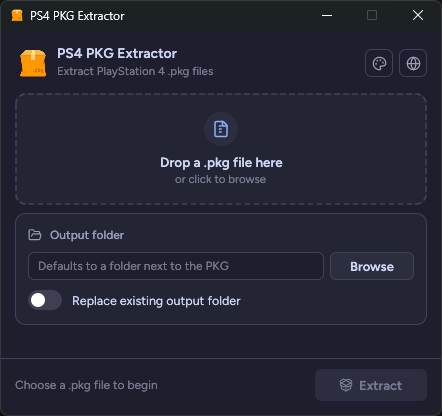
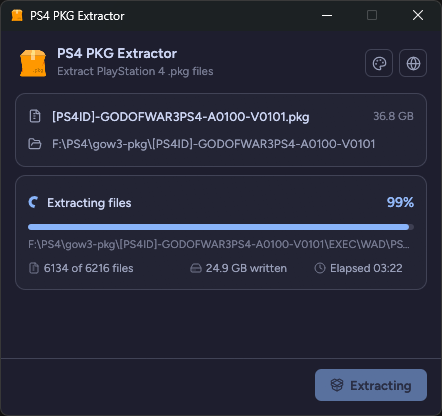

### `PS4 PKG Extractor`<br><sub><sup>Extract PlayStation 4 .pkg files, from a terminal or a window</sup></sub>

[](https://github.com/nexryx/ps4-pkg-extractor-gui/releases/latest)
[](LICENSE)

<br clear="left">

One program, two modes:

- Run from a terminal, it is a command line tool.
- Double-click it, drop a `.pkg` on it, or run it with `--gui`, and it opens a window.

<p align="left">
  
  
</p>

## Usage

```bash
pkgextract MY_GAME.pkg
pkgextract MY_GAME.pkg -o extracted/MY_GAME
pkgextract MY_GAME.pkg -f
```

- `-o, --output <DIR>`: output folder (default: next to the PKG, named after it)
- `-f, --overwrite`: replace an existing output folder
- `--gui`: open the window

## Install

Download the zip for your platform from [Releases](https://github.com/nexryx/ps4-pkg-extractor-gui/releases), or build from source:

```bash
cargo install --git https://github.com/nexryx/ps4-pkg-extractor-gui.git
```

## GUI

Built with egui and [fastframe](https://github.com/crmne/fastframe). It has a fixed-size window that opens centered, themes (Catppuccin by default; put your own palette JSON in the `themes` folder of the config directory), and English and Bahasa Indonesia.

## License

[The Unlicense](LICENSE). The GUI uses the [Figtree](licenses/Figtree-OFL.txt) font (SIL OFL 1.1) and [Lucide](licenses/Lucide-LICENSE.txt) icons (ISC and MIT).
